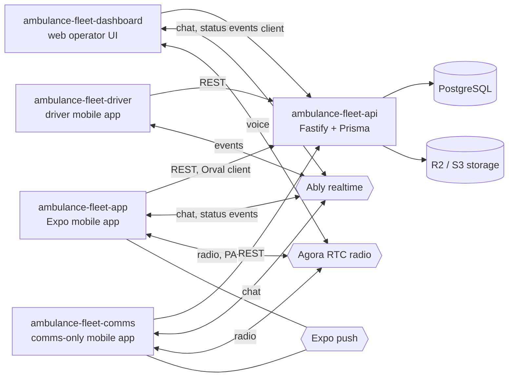

# Ambulance Fleet API

Multi-tenant backend for a fleet communications and operations platform for ambulance services: companies, bases, ambulances, shifts, status, chat and per-tenant module billing.

**Status:** prototype / work in progress, not presented as production. The REST API is implemented; the realtime (Ably token) and radio (Agora token) endpoints that the clients call are not in this repository (see "Known gaps").

## What it does

- Tenant hierarchy: company group > company > unit > base > ambulance (Prisma models in `prisma/schema.prisma`).
- Ambulance shifts, status codes, documents and destination commands.
- Chat and messages with read receipts (REST side).
- Module catalogue with billing types (fixed, per ambulance, per base, per driver-ambulance) enabled per company.
- External integrations record per company (a partner status feed and a drivers integration).
- Auth: sign-in, sign-out and auth-status routes with RS256 JWT in cookies.
- S3-compatible (Cloudflare R2) uploads through presigned URLs.
- OpenAPI document (`swagger.json`) and a Scalar API reference at `/docs` in development.

## Architecture



- The OpenAPI file is the contract: Orval generates typed React Query clients in the dashboard and the app from `swagger.json`.
- Clients obtain a short-lived Ably token request scoped to a tenant channel and an Agora token from the backend; the browser and phones then talk to Ably and Agora directly.
- Routes only validate and orchestrate; permissions live in `src/auth`.

## Key engineering decisions

- Multi-tenant RBAC with CASL: roles, subjects and tenant-scoped conditions in `src/auth/` and `src/http/helpers/casl.ts`.
- Zod type provider on every route, so validation, serialization and OpenAPI come from one schema (`src/http/routes/*`).
- Env validated at boot with zod (`src/env/index.ts`).
- Optional payload encryption hooks (`src/http/hooks/encrypt.ts`, `decrypt.ts`), currently not registered in `src/app.ts`.
- One Prisma migration baseline for all tables (`prisma/migrations`).

## Known gaps

- No Ably-token, radio or WebSocket routes in this repo; the clients call them on a backend that is not part of this portfolio set, so the clients cannot be run end to end from these repositories alone.
- No automated tests and no CI.
- Both `pnpm-lock.yaml` and `yarn.lock` are tracked; use pnpm.

## Tech stack

Node, TypeScript, Fastify 5, zod 4, Prisma 6 (PostgreSQL), @fastify/jwt, CASL, argon2, AWS SDK v3 (R2), Biome.

## Getting started

Prerequisites: Node 22+, pnpm, Docker (for Postgres).

```bash
cp .env.example .env            # fill placeholders
docker compose up -d            # Postgres, needs POSTGRES_PASSWORD
pnpm install
pnpm prisma generate
pnpm prisma migrate dev
pnpm dev                        # http://localhost:3333, docs at /docs
```

| Variable | Purpose |
|---|---|
| `PORT`, `ENV` | Listen port; development, staging or production |
| `DATABASE_URL` | PostgreSQL connection string |
| `CRYPTO_SECRET_KEY` | Key for the optional payload encryption |
| `JWT_PRIVATE_KEY`, `JWT_PUBLIC_KEY` | Base64 RS256 key pair |
| `AWS_*` | R2/S3 credentials, bucket, account, jurisdiction, public subdomain |
| `POSTGRES_*` | Used by `docker-compose.yml` only |

`api.http` holds sample requests (REST Client) with synthetic data.

## Testing

None yet. Type-check with `pnpm tsc --noEmit`.

## Project structure

```text
prisma/          schema and migrations
src/auth/        CASL abilities, roles, subjects
src/http/        routes, hooks, helpers, exceptions
src/env/         validated environment
src/lib/         storage client
swagger.json     generated OpenAPI contract
```

## Related repositories

- [ambulance-fleet-app](https://github.com/mkwitko/ambulance-fleet-app): mobile client
- [ambulance-fleet-dashboard](https://github.com/mkwitko/ambulance-fleet-dashboard): operator dashboard
- [ambulance-fleet-comms](https://github.com/mkwitko/ambulance-fleet-comms): communications app
- [ambulance-fleet-driver](https://github.com/mkwitko/ambulance-fleet-driver): driver app

## License

All rights reserved. Source available for portfolio review.
